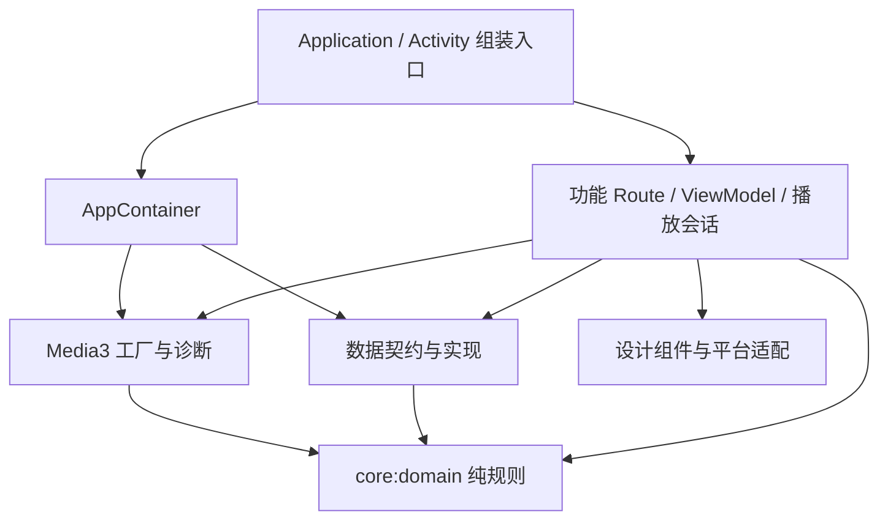

# 架构与扩展指南

Sweefl Player 采用一个 Android 应用模块和一个纯 Kotlin 规则模块。应用内按功能组织界面，平台能力、持久化和播放器配置分别集中管理。依赖由应用入口显式组装，播放会话跟随 Activity 生命周期。

## 模块与目录

```text
sweefl-player/
├── app/                         Android 应用、资源、清单与设备集成
│   └── src/main/java/com/sweefl/player/
│       ├── MainActivity.kt      媒体库启动入口与导航组装
│       ├── PlayerActivity.kt    播放入口、生命周期、SAF、PiP
│       ├── SweeflApplication.kt 应用级依赖容器入口
│       ├── di/                  显式依赖组装
│       ├── core/
│       │   ├── model/           Android 侧媒体模型
│       │   ├── platform/        文档名称、MIME 与持久读取授权
│       │   └── designsystem/    主题、颜色、背景与玻璃组件
│       ├── data/
│       │   ├── common/          兼容现有数据的 URI 摘要键
│       │   ├── history/         播放历史契约与 SharedPreferences 实现
│       │   ├── media/           MediaStore 查询、缩略图 I/O
│       │   └── preferences/     UA、流类型和应用偏好
│       ├── playback/
│       │   ├── engine/          Media3 创建、HTTP 和解码策略
│       │   ├── preview/         有限生命周期的静音目标帧预览
│       │   └── diagnostics/     播放采样、设备能力、诊断文件
│       └── feature/
│           ├── library/        Route、ViewModel、状态与列表 UI
│           ├── network/        URL/UA 输入界面
│           ├── player/         会话所有权、宿主契约、窗口适配与 UI
│           └── settings/       设置 UI 与偏好订阅适配
├── core/domain/                 无 Android 依赖的输入、MIME 和进度规则
├── gradle/                      版本目录、Wrapper、架构检查
├── tools/                       设备验证与报告脚本
└── docs/                        架构、开发说明与版本化验证证据
```

`:app` 依赖 `:core:domain`，后者不依赖应用或 Android SDK。应用里的 `core/model` 使用 Android `Uri`，属于 Android 适配层；它与独立的 JVM 规则模块职责不同。



## 职责与依赖边界

| 区域 | 负责 | 约束 |
| --- | --- | --- |
| 应用入口 / DI | 导航、依赖组装、Android 生命周期 | 只在这里获取应用容器；容器不保存 Activity 或播放器实例 |
| 功能 Route / ViewModel | 权限交互、状态加载、功能协调 | 仓库通过构造参数注入；取消查询时传播取消信号 |
| 功能 UI | 渲染状态、触发用户操作、局部交互状态 | 列表、弹窗不直接创建存储或执行 MediaStore 查询 |
| 播放会话 | 持有单个引擎、重建状态、字幕、诊断生命周期 | 生命周期由宿主驱动；不放进应用级单例或长期存活的 ViewModel |
| 数据层 | MediaStore、SharedPreferences、缩略图加载 | I/O 在相应调度器执行；不引用 Compose 或功能界面 |
| 播放基础层 | HTTP 工厂、解码器筛选、Media3 初始化、能力采样 | 不引用功能界面或 Activity |
| 设计组件 | 主题与折射渲染 | 通过参数 / CompositionLocal 接收设置，不读取偏好文件 |
| 纯规则模块 | URI/UA 校验、流 MIME、进度与时间规则 | 使用 JVM 单测验证；不导入 Android / AndroidX |

[架构检查](../gradle/architecture.gradle.kts)随 `verify` 执行，校验包名与目录一致、根包入口限制以及上述关键 import 边界。这是源码层约束；功能包仍共享 Android 模块，运行时行为由单测及真机回归共同验证。

## 媒体库的数据流

[LibraryRoute](../app/src/main/java/com/sweefl/player/feature/library/LibraryRoute.kt)负责权限、文件选择器和页面恢复事件。[LibraryViewModel](../app/src/main/java/com/sweefl/player/feature/library/LibraryViewModel.kt)接收 `VideoRepository` 与 `PlaybackHistoryRepository`，暴露只读 `StateFlow<LibraryState>`；书签成为状态的一部分。

[LibraryScreen](../app/src/main/java/com/sweefl/player/feature/library/ui/LibraryScreen.kt)接收状态、操作回调和缩略图加载函数。筛选、排序、文件夹、弹窗等局部显示状态保留在 Compose 中。MediaStore 查询与缩略图实现集中在[媒体数据层](../app/src/main/java/com/sweefl/player/data/media/)。权限撤销会取消查询并清空不可继续展示的列表；旧扫描不能在取消后覆盖新状态。

## 播放的所有权与生命周期

[PlayerActivity](../app/src/main/java/com/sweefl/player/PlayerActivity.kt)保留系统入口、Intent 解析、SAF 回调、窗口及画中画协调。[PlaybackSession](../app/src/main/java/com/sweefl/player/feature/player/PlaybackSession.kt)持有引擎、原始恢复位置、速度、轨道参数、外置字幕及诊断订阅。

- `onStart` 建立会话的引擎；`onStop` 保存并释放。
- 可见 PiP 只有 `onPause`，继续播放；彻底隐藏 / 关闭才释放。
- 字幕选择器期间关闭自动 PiP，并保留返回后的播放意图。
- 切换解码器保留原始位置；观看历史单独使用“最后三秒从头开始”的规则。
- 外置字幕使用稳定 ID `sweefl-external`，轨道可用后明确选择；移除时清除旧的文本轨道覆盖。
- `key(engine)` 确保重建后旧引擎的 UI 监听与计时协程释放。

[PlayerEngineFactory](../app/src/main/java/com/sweefl/player/playback/engine/PlayerEngineFactory.kt)是网络、解码及音频策略的集中入口。HTTP 数据源向媒体、清单和分片传递同一 UA。SOFTWARE 筛选与初始化回退始终限定在软件解码器集合。

[PlayerHost](../app/src/main/java/com/sweefl/player/feature/player/PlayerHost.kt)定义界面需要的状态与宿主操作。[PlayerWindowController](../app/src/main/java/com/sweefl/player/feature/player/platform/PlayerWindowController.kt)承接窗口亮度、媒体音量、系统栏和方向切换。播放 UI 继续使用 Media3 的播放与轨道接口，避免另造一套重复的播放器 API。

## 设置与兼容契约

[AppContainer](../app/src/main/java/com/sweefl/player/di/AppContainer.kt)使用 Application Context 创建仓库、设置和引擎工厂。[PlayerPreferences](../app/src/main/java/com/sweefl/player/data/preferences/PlayerPreferences.kt)仅提供存储及监听接口；Compose 订阅位于功能设置适配层。根组合将玻璃开关提供给设计组件。

以下内容是现有安装和自动化的兼容契约：

- 应用 ID 与入口 `com.sweefl.player.MainActivity` / `PlayerActivity`。
- Intent 参数 `title`、`userAgent`、`decodeMode` 与 `AUTO` / `SOFTWARE` 值。
- 保存状态中的 position、speed、selection、subtitle 等原有键。
- `playback_history`、`playback_config`、`player_preferences` 文件及既有键；URI 使用原始 UTF-8 字节的 SHA-256，不做归一化。
- 诊断 JSON 文件名、schemaVersion 和字段，以及中文控件描述。
- 既有默认 UA 字符串保持兼容，不因本次结构版本升级自动改写用户设置。

## 渲染、诊断与扩展

[设计组件](../app/src/main/java/com/sweefl/player/core/designsystem/)统一按钮、输入、开关、滑块和弹窗。媒体库镜片折射同一解析场景；播放控件和弹窗共享最大 480×320、播放最高 8fps / 暂停 2fps 的视频取样。隐藏控件、PiP 或 Activity 停止时停止取样，恢复可见后重建；主视频保持 SurfaceView，镜片是 SDR UI，不能作为 HDR 还原证明。

[预览基础层](../app/src/main/java/com/sweefl/player/playback/preview/)只接收 `PreviewSource` 和明确注入的诊断开关，不引用功能层、Activity 或 BuildConfig。功能 UI 在拖动时拥有控制器，离开窗口或 `ON_STOP` 时关闭；它的暂停引擎不写历史、不播放音频，也不替代主引擎。请求串行与目标去重、纹理锁存和实际帧时间共同决定能否显示图片，失败则降级为时间提示。三区动作、横向目标限幅和帧时间算术位于纯规则模块。详细边界见 [0.3.0 说明](LIQUID-GLASS-0.3.0.md)。

[诊断层](../app/src/main/java/com/sweefl/player/playback/diagnostics/)将设备能力枚举与每个播放器的采样分开，仍使用两秒间隔、后台文件写入和原子文件替换。测试参数继续仅在 Debuggable 构建启用。

扩展位置：新增媒体来源实现 `VideoRepository`；替换历史存储实现 `PlaybackHistoryRepository` 并处理迁移；解码 / 网络策略改工厂；播放交互改功能 UI / 宿主契约；新视觉组件放设计层并显式传入数据。只有在复用和独立构建需求明确时，才把应用内的包进一步提取为 Android Library 模块。

构建、测试和提交约定见[开发指南](DEVELOPMENT.md)。格式、HDR 和功耗能力的既有边界见[0.2.0 验证报告](VALIDATION-0.2.md)，本次重构回归见[0.2.1 重构记录](REFACTOR-0.2.1.md)。
